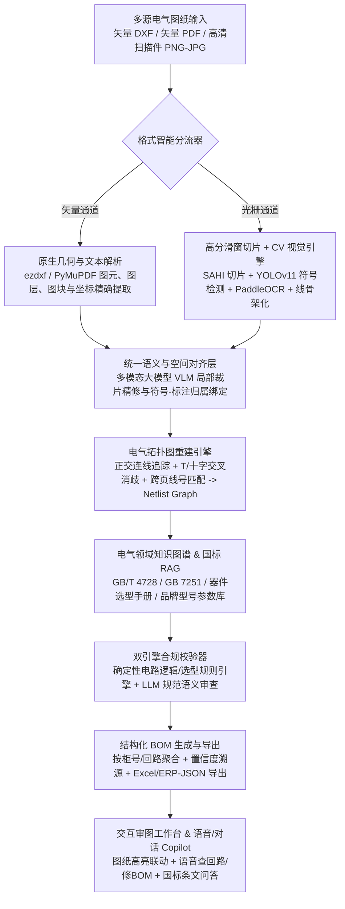

# 参赛实施方案：《图枢电析（ElectroGraph BOM）》——面向成套电气图纸的多模态拓扑解析与BOM合规生成系统

> **所属赛道**：首届江苏省“人工智能+”创新应用大赛 · “人工智能+”工业制造赛道  
> **对应赛题**：`AI-MFG-Q21` 电气图纸智能解析与BOM自动生成（命题单位：中国联合网络通信有限公司镇江市分公司）  
> **团队信息**：`盼盼法式小面包` ｜ 参赛组别：`创新组` ｜ 报名编号：`REG-2026-000523`  
> **赛题原始档案**：[challenge_info.md](./challenge_info.md) ｜ [challenge_raw.json](./challenge_raw.json)

---

## 一、项目概述与痛点破局

### 1.1 产业背景与核心痛点
江苏镇江（尤其是“中国工程电气岛”扬中）集聚了全国领先的高低压成套开关设备、母线槽与工业电气制造集群。在成套开关柜（如 KYN28、MNS、GCS、GGD、动力控制箱）招投标报价、深化设计与生产下料过程中，工程师每天需面对大量来自不同设计院的**一次系统图（单线图）与二次控制原理图**，核心痛点集中在四点：

1. **人工识图与统计 BOM 耗时极长、错漏频发**：一张复杂配电室一次图+二次控制图往往包含数百个断路器、接触器、互感器、继电器与接线端子，资深电气工程师人工摘录并核对 BOM 需 2–6 小时，易发生漏算极数、看错脱扣电流、误读相数等高成本报价失误。
2. **图纸格式与画法高度异构，传统规则/通用模型泛化差**：上游图纸既有矢量 CAD（DXF/DWG、矢量 PDF），也有扫描蓝图/压缩 PDF；不同设计院图块命名、符号比例、文字摆放和简写习惯差异巨大（如 `NSX100F TM80D 3P` 与 `塑壳断路器 100A/80A 3极`），通用 OCR 和纯 VLM 容易出现局部小符号漏检与文字归属错位。
3. **只“认字”不“懂拓扑”，无法自动验证回路逻辑**：现有识图工具大多停留在表格抽取或单点符号识别，缺乏“符号—端口—导线—跨页标号”的拓扑重建能力，无法还原母线馈出层级与二次控制自锁/互锁回路。
4. **选型规范与回路合规全靠人工经验兜底**：上下级断路器额定电流级差倒挂、导线截面积载流量低于保护脱扣电流、电流互感器变比与回路负荷不匹配、热继电器过载保护缺失等隐患，往往要到出厂调试甚至现场送电阶段才暴露。

### 1.2 项目定位与核心目标
**《图枢电析（ElectroGraph BOM）》** 是一套面向工业电气研发设计的**“矢量/视觉双通道解析 + 电气拓扑图重建 + 国标知识图谱合规校验 + 语音/自然语言协同审图”**多模态智能系统。严格对标赛题核心指标：

| 考核维度 | 赛题硬指标要求 | 本方案目标指标 | 验证与保障机制 |
| :--- | :---: | :---: | :--- |
| **图纸综合解析准确率** | **≥ 93%** | **≥ 95.5%** | 矢量精确几何抽取 + 光栅高分滑窗检测 + VLM 局部精修 |
| **BOM 生成完整率** | **≥ 95%** | **≥ 97.0%** | 拓扑关联去重汇总 + 型号规格标准化解析 + 低置信度人工复核闭环 |
| **设计规范语义匹配** | 支持语义匹配与回路/选型合规校验 | 覆盖 **40+ 条**核心国标与回路逻辑规则，支持证据回溯 | `GB/T 4728 / 5094 / 7251 / 14048` 知识图谱 + 确定性规则引擎 + RAG |
| **单图平均处理耗时** | 显著缩短人工识图耗时 | **≤ 15 秒 / 张**（相比人工 120 分钟提效 > 95%） | 异步流水线 + 轻量化检测模型 + 局部按需调用 VLM |

---

## 二、总体技术架构设计

系统采用五层解耦架构，完整覆盖赛题要求的**计算机视觉、大语言模型/多模态大模型、RAG 检索增强、知识图谱、语音识别/智能交互**全部五大技术方向：

---

## 三、核心关键技术深度设计

### 3.1 矢量/光栅双通道混合解析（破解不同设计院风格泛化难题）
1. **矢量通道（精度优先）**：对 DXF 与矢量 PDF，直接解析 `LINE` / `POLYLINE` / `ARC` / `CIRCLE` / `INSERT(Block)` 及 `TEXT/MTEXT` 精确坐标，将图块几何轮廓与标准符号模板进行几何特征匹配；同时将图面渲染为高分辨率光栅图辅助视觉交叉验证，解决“散线画符号（未建 Block）”的常见痛点。
2. **光栅通道（泛化优先）**：针对大画幅（A1/A0 等效 4000×6000 px）电气图纸中元器件极小、密集排列的特点，采用 **SAHI（Slicing Aided Hyper Inference）重叠滑动窗口切片** + **YOLOv11-OBB/Det 电气符号检测器**，结合文本检测识别（PaddleOCR 电气专用字典：支持 `QF`、`KM`、`FR`、`FU`、`TA`、`QS`、`3P/4P`、`In=63A`、`C65N`、`YJV-4×25+1×16` 等工业符号与特殊字符）。
3. **基于空间图与 VLM 的属性精准归属**：针对标注文本距离符号远近不一、多回路并行拥挤的问题，构建符号与邻近文本的二分图匹配（综合欧氏距离、读写流向、位号前缀映射如 `QF1 -> 断路器`），对低置信度歧义区域自动裁剪 512×512 局部 ROI 送入多模态大模型（如 Qwen2.5-VL）进行上下文语义精修与非标缩写归一化。

### 3.2 电气连线追踪与拓扑图重建（Graph / Netlist）
将图纸从“像素/框集合”升维为可计算的**电气拓扑图 $G = (V, E)$**：
- **节点集合 $V$**：元器件实体（含标准类型、位号 `tag`、规格参数 `specs`、端口引脚坐标 `ports`）、母线节点（`Busbar`）、接线端子排（`Terminal`）及跨页引用锚点（`Off-Page Connector`）。
- **边集合 $E$**：电气连接关系（含导线规格、相序/极数、回路编号 `circuit_id`）。
- **关键算法**：
  1. 剔除元器件框内与文字框内像素后，对导线做形态学细化（Zhang-Suen 骨架化）与正交线段合并；
  2. **交叉点消歧**：检测四向十字路口处是否存在实心连接点（Junction Dot）或跨线弧（Jump Arc）——有圆点为电气连通节点，无圆点直交则判定为独立跨线（消除拓扑误连）；
  3. **一次/二次回路语义分层**：一次图自动重建树状配电拓扑（进线总断路器 → 母排 → 各级馈线开关 → 互感器/仪表 → 负载）；二次图重建电源正负母线间的逻辑串并联通路（急停、常闭/常开触点、线圈、指示灯）。

### 3.3 电气知识图谱、国标 RAG 与双引擎合规校验
1. **三层电气领域知识图谱**：
   - **符号与代号层**：`GB/T 4728` 图形符号、`GB/T 5094` 文字符号（`QF` 断路器、`QS` 隔离开关、`KM` 接触器、`FR` 热继电器、`FU` 熔断器、`TA/TV` 互感器、`SPD` 浪涌保护器）；
   - **元器件参数与选型层**：主流成套开关器件系列参数映射（壳架电流 `Inm`、额定电流 `In`、极数、分断能力 `Icu`、脱扣曲线 `B/C/D`、电缆载流量对照表）；
   - **设计规范条文层**：切片化入库 `GB 7251`、`GB/T 14048`、`GB 50054`（低压配电设计规范）等条款，支持向量+关键词混合 RAG 精准溯源。
2. **确定性规则引擎 + LLM 语义合规校验（四类典型缺陷必查）**：
   - **上下级保护级差校验**：沿拓扑父子节点检查 $I_{n,\text{上级}} \ge k \cdot I_{n,\text{下级}}$（常见选型级差系数 $k \ge 1.6$），检出“小总开关带大支路开关”倒挂错误；
   - **导线载流量与保护匹配校验**：依据导线材质/截面积（如 `BV-2.5`、`YJV-4×16`）查表获取允许持续载流量 $I_z$，校核 $I_b \le I_n \le I_z$，防止导线过载发热风险；
   - **器件配套完整性校验**：检查电机主回路是否同时具备短路保护（`QF/FU`）+ 控制通断（`KM`）+ 过载保护（`FR`），检查互感器二次侧是否缺失接地/测量回路；
   - **二次回路逻辑闭环校验**：基于拓扑可达性校验电机启停回路自锁支路、正反转双接触器常闭互锁接点及急停串联优先级，并由 LLM 结合检索到的国标原文输出人类可读的整改建议与条款出处。

### 3.4 语音识别与自然语言智能交互 Copilot
面向现场工程师戴手套/边看图边核对的真实习惯，集成轻量化语音识别（ASR）与图纸智能问答：
- 支持语音/文字查询：“帮我高亮 `WL3` 回路所有元件”、“查一下 `QF2` 到下级断路器有没有级差风险”、“把所有 `C65N 32A` 的品牌统一替换为正泰 `NXB-63` 并重新导出 BOM”；
- 所有修改自动同步更新拓扑图与 BOM 清单，并保留修改留痕日志。

---

## 四、标准化数据集与量化评测基线方案

为直接响应赛题的“标准化数据集”交付物与 **≥93% / ≥95%** 量化门槛，构建 **`ElectroBench-JS` 标准化电气图纸评测数据集**：

### 4.1 数据集规格与分层设计
| 子集类型 | 图纸类型覆盖 | 标注内容 | 设计用途 |
| :--- | :--- | :--- | :--- |
| **标准一次配电系统图子集** | 低压配电柜（GGD/MNS/GCS）、建筑/厂房配电箱系统图 | 符号检测框（25+ 类国标符号）+ 属性 JSON + 拓扑树 + 标准 BOM CSV | 评测符号解析、规格绑定与 BOM 完整率 |
| **二次控制原理图子集** | 电机星三角启停、正反转互锁、消防联动、双电源切换 | 线圈/触点/端子/线号标注 + 二次网表 Netlist + 逻辑真值 | 评测交叉点消歧与二次逻辑拓扑重建 |
| **跨风格退化与规范缺陷注入集** | 扫描模糊/倾斜/非标简写图纸 + 人工注入的 4 类合规错误 | 退化参数标注 + 缺陷位置坐标 + 命中规范条文编号 | 评测泛化鲁棒性与合规校验 Precision / Recall |

### 4.2 评测口径与基线对比设计
明确定义与赛题完全对齐的评测指标：
- **图纸解析准确率** $= 0.4 \times \text{符号检测 F1} + 0.35 \times \text{规格属性绑定准确率} + 0.25 \times \text{拓扑连接边 F1}$；
- **BOM 生成完整率** $= \frac{\text{正确提取且规格/数量一致的 BOM 项数}}{\text{人工标准真值 BOM 总项数}} \times 100\%$；
- **对照基线**：① 通用 OCR + 正则模板；② 纯多模态大模型直接识图（端到端 VLM）；③ **本方案（双通道解析 + 拓扑重建 + 国标 KG 校验）**，在离线评测报告中给出分场景消融表与误差归因分析。

---

## 五、可演示 AI 平台 MVP 模块设计（Phase 2 开发蓝图）

前端采用简洁高质感工业深浅双态工作台，核心界面划分为 4 个联动区：
1. **图纸上传与双通道解析看板**：支持拖拽上传样例图纸（内置 3–5 张涵盖一次配电系统图、二次电机控制图及含缺陷校验图的真实感样例），实时展示解析进度与元器件检测框叠加图层。
2. **交互式电气拓扑图视图（Graph Canvas）**：左侧图纸点击任意元器件或回路，右侧拓扑图同步高亮上下游父子关系与电气连接路径。
3. **结构化 BOM 与国标合规体检台**：
   - 自动汇总展示可筛选/可内联编辑的 BOM 表格，标注每项置信度及图纸坐标锚点，一键导出标准 Excel/CSV/JSON；
   - 独立“合规校验红黄灯面板”列出所有风险条目（严重/警告/通过），点击即可在图纸上闪烁定位错误元器件并弹出 `GB 50054 / GB 7251` 条文依据与修复建议。
4. **审图语音/对话 Copilot 侧边栏 & 离线评测面板**：支持麦克风语音输入或文本指令交互改图/问规范；内置“评测基线页”一键呈现 `ElectroBench-JS` 上本系统 vs 通用 VLM 基线的 93%+/95%+ 达标可视化图表。

---

## 六、部署实施、竞品对比与产业化落地

### 6.1 竞品差异化对比
| 对比维度 | 传统人工识图 | CAD 二次开发插件（EPLAN/天正等） | 通用大模型直接识图 | **图枢电析（本方案）** |
| :--- | :---: | :---: | :---: | :---: |
| 支持非标/扫描 PDF 图纸 | 依赖人眼 | 仅限特定原生源格式 | 支持但细节漏检严重 | **矢量+光栅双通道全兼容** |
| 电气拓扑与跨页逻辑重建 | 人工脑补 | 需严格规范建块 | 基本无法重建精准网表 | **自动重建可计算拓扑图** |
| 国标与选型合规自动审查 | 依赖老工程师经验 | 规则死板难扩充 | 存在条款幻觉 | **KG+确定性规则+RAG 精准溯源** |
| 单张复杂图纸出 BOM 耗时 | 2–6 小时 | 仅原生规范图可用 | 需大量人工返工核对 | **≤15 秒 + 低置信度精准复核** |

### 6.2 落地路径与私有化安全部署
- **私有化/信创部署**：工业设计图纸属于企业核心商业机密，方案支持全栈容器化（Docker/K8s）本地私有化部署于厂区内网或镇江联通工业互联网算力节点，支持国产昇腾/海光推理加速，确保图纸“不出厂、不泄密”。
- **江苏产业推广节奏**：第一阶段切入扬中/镇江高低压成套开关柜制造企业报价与工艺部门（解决“招投标快速算量报价”刚需）；第二阶段对接企业 ERP/MES/PLM 系统实现“图纸→BOM→采购询价→产线领料”全链贯通；第三阶段沉淀行业标准化电气符号与规范数据集，向全省装备制造与新能源配电产业复制。

---

## 七、初赛核心交付物蓝图

### 7.1 20 页答辩 PPT 结构大纲
- **P1–P2**：封面与核心亮点速览（紧扣扬中/镇江成套电气痛点与 93%/95% 指标达标成果）
- **P3–P4**：行业痛点实证（人工识图成本、跨院画法异构、隐性选型违规风险）
- **P5–P6**：《图枢电析》总体架构与五大技术融合全景图
- **P7–P9**：核心技术突破一（矢量/光栅双通道 + SAHI 高分解析）、突破二（拓扑网表重建与交叉消歧）、突破三（国标 KG + 双引擎合规校验）
- **P10–P11**：语音/自然语言审图 Copilot 与人机协同纠错闭环
- **P12–P14**：`ElectroBench-JS` 标准化数据集构建规范与定量基线评测结果（消融实验 + 误差分析）
- **P15–P16**：平台核心功能实景演示截图（图纸高亮、拓扑图、BOM 导出、合规报错定位）
- **P17–P18**：竞品分析、私有化安全部署方案与扬中/镇江产业落地经济效益测算
- **P19–P20**：团队分工、项目演进路线图与合作展望

### 7.2 5 分钟演示视频分镜脚本（建议 1080P，控制 4 分 30 秒）
1. **0:00–0:40（痛点与产品亮相）**：成套开关柜一次/二次图纸识图痛点引入，亮出《图枢电析》定位与核心达标数据。
2. **0:40–1:45（核心演示一：一次配电系统图全自动解析→拓扑→BOM）**：真实上传一次系统图，动态展示符号识别框、规格绑定、一键生成结构化配电拓扑与可编辑 BOM 表，并导出 Excel。
3. **1:45–2:50（核心演示二：自动抓错与国标溯源）**：切换至含隐性缺陷的图纸（断路器级差倒挂 + 电缆载流量不足），展示系统自动亮红灯、图纸定位闪烁、弹出 `GB 50054` 条款依据及一键修复方案。
4. **2:50–3:35（核心演示三：二次控制原理图逻辑校验 + 语音/自然语言交互）**：展示二次互锁拓扑重建，并用自然语言/语音指令查询特定回路元件与一键更新 BOM。
5. **3:35–4:30（定量评测看板与落地价值收尾）**：展示 `ElectroBench-JS` 评测面板（解析准确率、BOM 完整率对比通用 VLM 基线提升）及对接镇江/江苏电气制造产业的商业价值。

### 7.3 交付自查表
- [x] 完成官网 `AI-MFG-Q21` 报名（`REG-2026-000523`，创新组）
- [ ] 完成可交互 Web 原型与 `ElectroBench-JS` 评测脚本跑通
- [ ] 输出《项目计划书》（PDF）、《答辩 PPT》（≤20 页）、《演示视频》（MP4 ≤5 分钟）、《佐证材料：数据集与评测报告》（PDF）
- [ ] 全文件按 `人工智能+工业制造赛道-图枢电析-盼盼法式小面包` 命名并上传至百度网盘根目录
