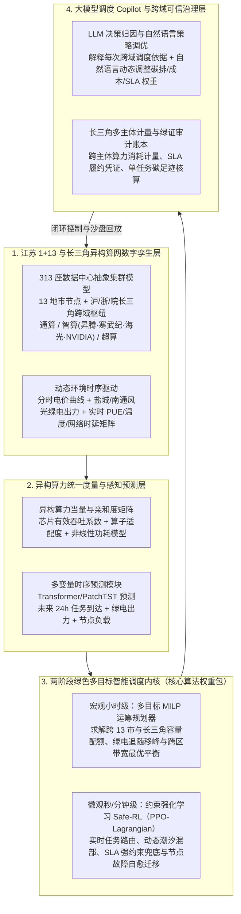

# 参赛实施方案：《苏算绿枢（SuCompute-Opt）》——面向省级一体化异构算力网的多目标绿色智能调度与数字孪生仿真平台

> **所属赛道**：首届江苏省“人工智能+”创新应用大赛 · “三苏”（苏模、苏算、苏数）创新应用赛道  
> **对应赛题**：`AI-JIANGSU-Q36` 异构算力智能调度与能效优化（命题单位：江苏省数据集团有限公司）  
> **团队信息**：`盼盼法式小面包` ｜ 参赛组别：`创新组` ｜ 报名编号：`REG-2026-000524`  
> **赛题原始档案**：[challenge_info.md](./challenge_info.md) ｜ [challenge_raw.json](./challenge_raw.json)

---

## 一、项目概述与江苏算网背景对齐

### 1.1 真实底座与政策牵引
江苏省数据集团承建运营的“中国算力平台（江苏）暨江苏省一体化算力调度监测平台”已构建起**“省级调度核心 + 13 个市级节点”**两级体系，纳管全省 **313 座在用数据中心**，总算力规模达 **271.8 EFlops**，形成城域 **1ms 时延圈**，并实现与上海、浙江、安徽长三角算力调度平台互联互通。2026 年 11 月江苏省政府办公厅印发《促进平台经济创新和规范健康发展若干措施》，进一步明确“持续完善全省一体化算力监测调度平台功能，强化长三角算力枢纽节点功能”。

然而，在大规模异构算力并网运营中，调度层仍面临四大瓶颈：
1. **异构资源度量割裂**：通算（x86/ARM）、智算（国产昇腾 Ascend、寒武纪 MLU、海光 DCU 与 NVIDIA GPU 混部）、超算并存，峰值算力（FP16/BF16/FP64）与真实业务有效吞吐差异悬殊，缺乏跨芯片统一调度度量口径。
2. **多态任务供需错配与空转并存**：大模型预训练（长周期、可移峰、高卡间通信）、LoRA 微调（中周期弹性）与在线推理（强 1ms–10ms 时延 SLA、潮汐波峰显著）混合到达，导致苏南高峰排队、苏北与夜间闲时严重空转。
3. **绿色算力与能耗双控难以直达调度层**：PUE（1.15–1.55）、区域碳排放因子与苏北沿海风电/光伏（盐城、南通、连云港）波动性绿电出力未纳入调度目标函数，绿色算力停留在事后统计而非事前优化。
4. **长三角跨域协同、计费与故障切换缺智能决策**：跨省/跨运营主体间存在网络带宽成本、差异化电价、SLA 违约罚金与突发节点宕机风险，人工规则难以实现秒级无感迁移与透明归因。

### 1.2 项目定位与量化优化目标
**《苏算绿枢（SuCompute-Opt）》** 是一套面向省级一体化算力网的**“异构当量建模 + 时序负荷/绿电预测 + 两阶段（MILP + Safe-RL）多目标绿色调度 + LLM 运维解释 + 1+13 长三角数字孪生沙盘”**智能调度引擎与仿真验证平台。

| 核心优化指标 | 传统静态/贪心基线痛点 | 本方案仿真验证目标（相对基线改善） |
| :--- | :--- | :--- |
| **综合算力资源利用率** | 峰谷错配，平均约 55%–68% | **提升 +15% 至 +22%**（突破 80%+ 高效区间） |
| **SLA 达标率（含 1ms/10ms 推理与训练截止期）** | 高峰期排队违约率 6%–12% | **≥ 99.2%**（强约束兜底，故障场景秒级切换） |
| **加权平均 PUE 与单位算力能耗** | 忽略机房能效与部分负载非线性能耗 | 单位有效算力能耗 **降低 12%–18%**，加权 PUE 优化 **0.06–0.10** |
| **绿电消纳率与碳排放强度** | 未感知沿海风光电出力曲线 | 绿电消纳占比 **提升 +18%–25%**，碳排强度 **降低 15%–22%** |
| **单节点故障/拥塞自愈切换时长** | 人工介入分钟级至小时级 | **≤ 3 秒策略重算与跨节点无感编排** |

---

## 二、总体技术架构设计

完整贯通官方要求的**时序数据分析、强化学习、大语言模型/多模态大模型、数字孪生、运筹优化与多目标调度算法**五大技术方向：

---

## 三、核心算法与数学模型深度设计

### 3.1 异构算力统一抽象与非线性功耗建模
针对通算、智算、超算及国产/进口芯片口径不一的问题，定义**任务类型 $k \in \{\text{Pretrain}, \text{Finetune}, \text{Inference}, \text{HPC}, \text{General}\}$** 在 **异构算力池 $m \in \mathcal{M}$** 上的**有效算力当量系数 $\eta_{k,m}$** 与 **国产芯片迁移适配增益**：
- 例如：大语言模型批处理推理与 LoRA 微调在国产昇腾/寒武纪/海光节点上经算子图优化后具备高性价比（$\eta_{k,m} \in [0.85, 0.98]$）；万卡紧耦合预训练优先匹配高速互联超节点（如昇腾灵衢/NVLink 集群）。
- **节点真实功率与碳排在线模型**：
  $$P_i(t) = \text{PUE}_i(u_i(t), T_i(t)) \cdot \Big(P_i^{\text{idle}} + (P_i^{\text{peak}} - P_i^{\text{idle}}) \cdot u_i(t)^{\alpha}\Big)$$
  $$C_i(t) = P_i(t) \cdot \Delta t \cdot \max\Big(0,\ 1 - r_i^{\text{green}}(t)\Big) \cdot \gamma_i^{\text{grid}}$$
  其中 $u_i(t)$ 为节点 $i$ 在时段 $t$ 的综合利用率，$\alpha$ 刻画服务器动态功耗凸性，$r_i^{\text{green}}(t)$ 为节点 $i$ 实时可消纳风光电绿电比例，$\gamma_i^{\text{grid}}$ 为华东电网区域排放因子。该建模避免“为省单机功耗而把任务过度分散导致空载基线功耗浪费”，天然引导算法做**紧凑装箱（Bin-Packing）+ 绿电时段/区域追随（Follow-the-Renewables）**。

### 3.2 两阶段多目标调度优化内核（MILP + Safe-RL）

#### 第一阶段：宏观小时级“时空移峰 + 绿电消纳”MILP 运筹规划
以 24 小时滚动时域（Receding Horizon）规划省内 13 地市及沪浙皖长三角跨域算力容量配额 $x_{j,i,t}$，最小化加权多目标函数：
$$\min \sum_{t=1}^{T} \sum_{i \in \mathcal{N}} \Big( w_1 \cdot \text{Cost}_i^{\text{elec}}(t) + w_2 \cdot C_i(t) + w_3 \cdot \text{Cost}_{i}^{\text{net}}(t) - w_4 \cdot U_i^{\text{util}}(t) \Big)$$
严格满足：
- **时延圈硬约束**：在线推理任务仅允许调度至满足端到端网络时延 $L_{\text{src}, i} \le L_j^{\text{max}}$ 的节点（利用江苏城域 1ms / 省内 5ms / 长三角 10ms 算网分级拓扑）；
- **可移峰训练任务时间窗约束**：训练/微调任务在交付截止期 $D_j$ 前自动向苏北（盐城/南通/宿迁）绿电波峰或夜间低谷电价节点迁移；
- **国产算力保底与跨省配额约束**：支持按政策配置国产算力最低调度占比与长三角跨域互联带宽上限。

#### 第二阶段：微观实时级约束强化学习（PPO-Lagrangian Safe-RL）
面对突发性任务波峰、实际执行时长偏差及单机房故障，构建马尔可夫约束决策过程（CMDP）：
- **状态空间 $s_t$**：当前待调度任务特征（类型、所需算力、显存/互联需求、时延上限、截止期）+ 13 地市及沪浙皖各算力池实时利用率、排队深度、剩余绿电余量、实时 PUE、跨区 RTT 与健康状态；
- **动作空间 $a_t$**：选择目标算力节点与异构芯片池（支持在轨预训练任务断点续训/Checkpoint 跨区热迁移）；
- **奖励与安全约束**：主奖励最大化“吞吐收益 − 碳排惩罚 − 电费成本 − 跨区迁移开销”，同时通过拉格朗日乘子 $\lambda$ 强制约束**期望 SLA 违约率 $\mathbb{E}[\text{SLA\_Violation}] \le \epsilon$**（如 $\epsilon = 0.005$），保证即使在极端负载冲击下也不牺牲核心业务 SLA。

### 3.3 故障自愈切换与 LLM 可解释运维助手
- **跨域故障自愈**：仿真器支持一键注入“某地市核心智算中心断网/过载/PUE 飙升”事件，Safe-RL 引擎结合检查点状态与网络带宽余量，在秒级内将受影响的高优推理无缝切流至 1ms/5ms 邻近节点，将训练作业重编排至长三角备选集群。
- **LLM 调度 Copilot**：将 MILP 对偶价格（Shadow Price）与 Safe-RL 决策特征转为自然语言归因报告，支持调度员用中文指令即时切换运行模式（如“迎峰度夏保电模式：将碳排与能耗权重调高至 0.6，非紧急微调任务全部移至盐城与芜湖夜间执行”）。

---

## 四、仿真评测与能耗对比基线方案

为完全满足官方“可量化、可仿真验证”及“调度策略仿真评测报告与能耗对比基线”交付物要求，设计高保真开源风格仿真基准 **`JS-ComputeSim-313`**：

### 4.1 仿真场景参数（严格锚定官方真实规模）
- **拓扑规模**：构建对应江苏省 13 地市（南京、苏州、无锡、常州、镇江、南通、扬州、泰州、盐城、淮安、徐州、连云港、宿迁）313 座数据中心聚合节点 + 长三角 3 跨域枢纽（上海、浙江、安徽芜湖），总算力严格按 **271.8 EFlops** 等比映射。
- **异构芯片池构成**：按比例配置通算 CPU、智算（昇腾/寒武纪/海光国产智算池 + NVIDIA 智算池）及超算池，配置真实差异化 PUE（1.16–1.48）、苏南/苏北分时电价及盐城/南通等沿海节点 24 小时风光绿电出力曲线。
- **多态负载轨迹（7 天 × 24 小时仿真）**：基于真实云智算负载统计规律生成包含“白天推理潮汐波峰 + 夜间大模型训练批量提交 + 随机突发高优任务 + 第 4 天节点宕机故障注入”的完整测试集。

### 4.2 四算法对照基线矩阵
在完全相同的随机种子与负载轨迹下，对比以下 4 种调度策略并输出 6 维定量评测报告：
1. **Baseline 1 — 静态轮询/就近优先（Round-Robin / Local-First）**：模拟传统省市分散孤岛式人工派单；
2. **Baseline 2 — 负载均衡贪心（Least-Loaded Greedy）**：仅追求各集群利用率均匀，无视异构亲和度、PUE 与绿电；
3. **Baseline 3 — 纯电价/成本贪心（Cost-First）**：盲目向低电价节点堆积，易导致跨区拥塞与推理 SLA 违约；
4. **Ours — `SuCompute-Opt`（MILP 宏观规划 + Safe-RL 实时调度）**：多目标帕累托最优，同时输出消融实验（仅 MILP vs 仅 RL vs MILP+Safe-RL 混合）。

---

## 五、可演示 AI 平台 MVP 模块设计（Phase 2 开发蓝图）

打造一套视觉极具科技感与省级平台质感的**江苏算网绿色调度数字孪生交互平台**：
1. **江苏 1+13 + 长三角实时算网地图沙盘**：可视化呈现 13 地市及沪浙皖节点算力负载热力、实时 PUE、绿电比例与跨域任务调度飞线动画。
2. **多策略实时仿真对比引擎**：支持选择工作负载场景（常规工作日 / 绿电大发日 / 尖峰保电日 / 节点故障压测），一键并行运行 4 种调度算法，实时刷新 6 维 KPI 仪表盘与 24h 利用率/PUE/碳排对比曲线。
3. **单任务调度轨迹与碳足迹审计抽屉**：点击任意大模型训练或在线推理任务，查看芯片亲和度打分、选中节点原因、预计电费与碳减排量、跨域计量凭证哈希。
4. **LLM 调度 Copilot 交互面板**：支持自然语言下达策略权重调整（“优先绿电消纳”/“极致保 SLA”/“注入南京节点 30% 算力宕机故障”）并即时触发算法重算与文字归因解读。
5. **一键导出仿真评测报告与模型权重说明**：支持导出完整的对比 CSV 与评测摘要，直接支撑佐证材料。

---

## 六、部署实施与生态落地架构

- **非侵入式对接省级一体化平台**：采用“策略决策边车（Scheduling Advisor Sidecar）”微服务架构，通过标准 REST/gRPC 接口对接省一体化算力监测调度平台现有监控指标库（Prometheus/时序库）与 13 地市算力子门户，支持“影子模式（Shadow Mode 仅建议不介入）→ 人工审批半自动 → 全自动闭环调度”三阶段平滑上线。
- **国产化软硬件全栈兼容**：调度算法推理层（PyTorch/ONNX + 开源求解器 HiGHS/SCIP）轻量级 CPU/国产 NPU 均可毫秒级运行，不额外消耗高价值智算卡资源。
- **商业与社会价值**：以全省纳管 271.8 EFlops 算力折算，若全网平均资源利用率提升 10%、综合能耗下降 10%，每年可为江苏算力产业释放相当于数亿元等效算力供给，并显著助力江苏“双碳”目标与长三角算力统一大市场建设。

---

## 七、初赛核心交付物蓝图

### 7.1 20 页答辩 PPT 结构大纲
- **P1–P2**：封面与核心成果指标速览（紧扣省数据集团 1+13 / 313 中心 / 271.8 EFlops 真实场景）
- **P3–P4**：四大行业痛点拆解（异构度量、潮汐错配、绿电碳排、长三角跨域协同）
- **P5–P6**：《苏算绿枢》总体五层架构与五大技术融合蓝图
- **P7–P9**：核心技术一（异构芯片算力当量与非线性 PUE/碳排建模）、技术二（MILP 宏观时空移峰 + Safe-RL 实时安全兜底）、技术三（LLM 决策可解释与长三角计量凭证）
- **P10–P13**：`JS-ComputeSim-313` 高保真仿真环境设计与 4 基线 6 维定量评测对比（利用率/SLA/PUE/碳排/绿电消纳/故障自愈曲线与消融实验）
- **P14–P16**：数字孪生交互平台实景界面展示（江苏 1+13 地图沙盘、多策略压测、故障自愈与 Copilot 对话调权）
- **P17–P18**：非侵入式对接省一体化平台部署方案、信创安全合规与竞品对比
- **P19–P20**：经济社会效益测算、算法权重包开放规划与落地路线图

### 7.2 5 分钟演示视频分镜脚本（建议 1080P，控制 4 分 30 秒）
1. **0:00–0:40（背景与痛点）**：引出江苏一体化算力网 313 座数据中心、271.8 EFlops 与长三角互联场景，亮出《苏算绿枢》核心提升数据。
2. **0:40–1:50（核心演示一：1+13 长三角数字孪生沙盘动态仿真）**：实时回放 24 小时多态负载（训练/微调/推理），演示白天推理就近落入苏南 1ms 算网保 SLA、批量训练自动移峰至盐城/南通绿电高发区与长三角集群。
3. **1:50–2:55（核心演示二：4 策略定量评测基线实时对比）**：切换评测看板，逐项展示 `SuCompute-Opt` 相对 RR/Greedy/Cost-First 的利用率、SLA、PUE、碳排与绿电消纳对比曲线。
4. **2:55–3:50（核心演示三：故障注入自愈 + LLM 调度 Copilot）**：现场触发“某市智算节点故障”压测，演示秒级切流保 SLA，并用自然语言指挥 Copilot 调整绿色优先权重并查看决策归因与碳足迹凭证。
5. **3:50–4:30（部署接入与绿色价值收尾）**：展示边车式接入省平台架构、算法权重包清单与绿色算力减碳效益。

### 7.3 交付自查表
- [x] 完成官网 `AI-JIANGSU-Q36` 报名（`REG-2026-000524`，创新组）
- [ ] 完成 `JS-ComputeSim-313` 仿真引擎、Safe-RL/MILP 算法权重与可交互数字孪生 Web 原型
- [ ] 输出《项目计划书/行业解决方案白皮书》（PDF）、《答辩 PPT》（≤20 页）、《演示视频》（MP4 ≤5 分钟）、《佐证材料：仿真评测报告与能耗对比基线 + 部署实施方案》（PDF）
- [ ] 全文件按 `三苏创新应用赛道-苏算绿枢-盼盼法式小面包` 命名并上传至百度网盘根目录（含算法权重与可复现仿真代码）
