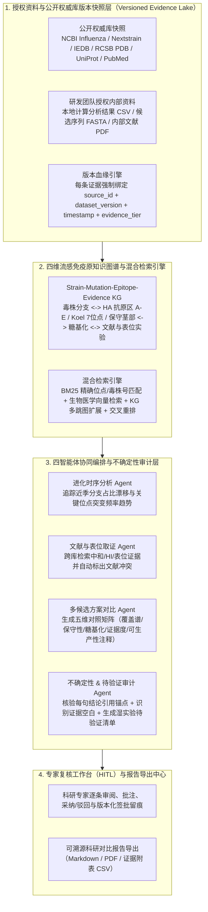

# 参赛实施方案：《流盾智研（FluVax-Evidence Agent）》——面向流感病毒免疫原辅助设计的全链条可溯源科研智能体平台

> **所属赛道**：首届江苏省“人工智能+”创新应用大赛 · “人工智能+”医疗健康赛道  
> **对应赛题**：`AI-HEALTH-Q40` 流感病毒免疫原辅助设计智能体研发和应用（命题单位：宿迁市楚润数据集团有限公司）  
> **团队信息**：`盼盼法式小面包` ｜ 参赛组别：`创新组` ｜ 报名编号：`REG-2026-000525`  
> **赛题原始档案**：[challenge_info.md](./challenge_info.md) ｜ [challenge_raw.json](./challenge_raw.json)

---

## 一、项目概述与科研合规边界

### 1.1 生物医药研发痛点
季节性流感病毒（甲型 H1N1pdm09、H3N2 及乙型 B/Victoria）表面血凝素（**HA**）与神经氨酸酶（**NA**）持续发生高频抗原漂移（Antigenic Drift），疫苗与广谱免疫原研发团队每个流感季都必须在极短时间窗口内整合海量异构信息来评估候选免疫原方案，面临四大科研效率与可信痛点：

1. **多源证据高度分散，人工检索整理极耗时**：病毒株流行序列在 NCBI/GISAID、进化分支趋势在 Nextstrain、免疫表位实验数据在 IEDB、蛋白三维构象在 RCSB PDB、中和实验结论分散于数万篇 PubMed 文献，外加团队内部授权的计算分析表，科研人员完成一次多候选方案证据综述往往耗费 **数天至数周**。
2. **数据版本迭代频繁，结论无法复现与溯源**：序列库与文献库每周更新，人工整理的 Excel/PPT 报告经常缺少版本号与原始 ID，跨团队评审时难以回答“这条保守性结论基于哪一版毒株集、引自哪篇文献”。
3. **单一黑盒 AI 预测分不可靠，易产生科学幻觉**：蛋白质语言模型或单点免疫原性打分不能替代湿实验与免疫学专家判断；通用大模型直接问答更常出现“编造 PMID、混淆 H3N2 与 H1N1 编号系统、隐藏冲突实验结果”等严重科研风险。
4. **不确定性与待验证事项缺乏显式闭环管理**：既有文献中常存在“鸡胚适应性突变（Egg-adapted mutations）vs 细胞培养株”中和活性分歧或新发分支证据空白，缺乏面向专家复核的结构化待验证清单生成机制。

### 1.2 项目定位与严格合规声明
**《流盾智研（FluVax-Evidence Agent）》** 是一款严格遵循**“证据先行、版本锁定、不确定性显式披露、专家复核签批（Human-in-the-Loop）”**原则的流感病毒免疫原科研辅助智能体平台。

> **核心科学边界声明（严格对齐赛题要求）**：本平台定位为**研发信息整理、跨库证据检索与多候选方案对比的离线辅助工具**；所有计算分析分数仅作为多维证据条目之一呈现，绝不替代湿实验或专家专业判断；本阶段交付软件原型、标准化循证评测集与离线效率基线评测，不以湿实验有效性或临床保护效果作为承诺。

---

## 二、总体技术架构设计

系统采用五层可信科研智能体架构，完整覆盖赛题要求的**大语言模型/多模态大模型、RAG 检索增强、知识图谱、时序数据分析**四大技术方向：



---

## 三、核心关键技术深度设计

### 3.1 证据版本血缘与四级证据分级模型（破解“版本难管、无法追溯”）
平台为每一条接入的公开或授权内部资料建立不可篡改的**证据胶囊（Evidence Capsule）**：
```json
{
  "evidence_id": "EV-2026-IEDB-004821",
  "source_type": "IEDB_BCELL_ASSAY",
  "primary_ref": "IEDB:194285 | PMID:36891234",
  "dataset_version": "IEDB-2026.10-snapshot",
  "ingested_at": "2026-11-27T08:00:00Z",
  "evidence_tier": "T1_WET_LAB_ASSAY",
  "subtype_context": "A/H3N2 | HA1 | Antigenic Site B (pos 158-160)",
  "claim_summary": "T160K 突变导致 158-160 位点潜在 N-糖基化丢失，影响部分血清交叉中和效价"
}
```
- **四级证据权重标注**：`T1` 湿实验测定（HI 血凝抑制、微中和 MN、晶体结构/冷冻电镜表位解析） > `T2` 流行病学大样本监测数据（NCBI/Nextstrain 进化分支占比） > `T3` 综述/同行评议文献观点 > `T4` 计算模拟预测结果（序列保守性、SASA 可及性、蛋白模型打分）。严禁模型将 `T4` 计算预测包装成 `T1` 实验定论。

### 3.2 四维流感免疫原知识图谱（Strain–Mutation–Epitope–Evidence KG）
精准建模流感免疫原设计的核心生物学实体与关系，解决通用 RAG 无法理解氨基酸位点编号（如 H3 经典编号系统 vs 全长信号肽编号偏移）的致命缺陷：
- **核心实体**：病毒亚型与进化分支（如 H3N2 `3C.2a1b.2a.2a.3a.1` / `J.2`、H1N1pdm09 `6B.1A.5a.2a.1`）、结构域（HA1 球状头部 `Antigenic Sites A/B/C/D/E`、Koel 7 个关键抗原转换位点 `145/155/156/158/159/189/193`、HA2 保守茎部 `Stem`）、序列突变事件（含潜在 N-糖基化位点 `N-X-S/T` 获得/丢失）、免疫表位（IEDB 线性/构象表位）及候选免疫原设计方案（野生参考株、共识序列 Consensus、嵌合 HA、无头茎部 Mini-HA 等）。
- **时序数据分析引擎**：基于带采样日期与地理标签的流行株序列集合，按月/季统计各分支占比演化趋势、关键抗原位点 Shannon 熵（变异性）及逃逸突变上升斜率，辅助研判候选免疫原面对未来流行趋势的“时间漂移脆弱性”。

### 3.3 多智能体循证编排与不确定性显式审计（Zero-Hallucination Guardrail）
1. **双路约束生成与逐句引文核验**：每条输出声明必须绑定至少一个有效 `evidence_id`；审计 Agent 对生成草稿做后置 NLI（自然语言推理）忠实度校验，若发现模型推演超出原文边界或无证据支撑，强制降级为“**[证据不足 / 待验证]**”或拒绝臆断。
2. **多候选免疫原方案五维对照引擎**：自动对研发团队输入的多个既有候选免疫原方案（如候选 A：最新季节参考株；候选 B：近 3 季共识序列；候选 C：去糖基化修饰 HA 头部；候选 D：保守茎部设计）进行统一口径横向比较：
   - ① **近季流行分支覆盖谱与时序漂移匹配度**（基于序列比对与流行趋势时序统计）；
   - ② **关键抗原表位保守性与结构可及性**（关联 IEDB + PDB 注释）；
   - ③ **糖基化屏蔽与鸡胚/细胞培养适应性风险**（基于序列 `N-X-S/T` 扫描与文献预警）；
   - ④ **支持证据充分度与文献冲突扫描**（统计 `T1–T4` 证据分布，高亮相互矛盾的文献条目）；
   - ⑤ **显式不确定性评级与建议优先开展的湿实验验证项**（如特定分支血清交叉 HI 测试、热稳定性/三聚体构象表征）。
3. **专家人工复核闭环（HITL）**：每位科研专家可对报告中的单条证据或结论执行“确认采纳 / 标记存疑 / 补充内部实验备注 / 驳回修正”，系统自动生成版本递增的正式复核报告与完整审计轨迹。

---

## 四、两类典型科研任务验证与离线效率基线方案

严格对标赛题“**不少于 2 类典型科研问答/证据比较任务验证，以固定人工流程作为效率基线**”要求，构建标准化离线评测集 **`FluEvidenceBench-v1`**（含可复现公开来源快照 + 领域专家标注标准证据清单）：

### 4.1 两类核心验证任务
1. **任务一：跨库科研循证问答与进化时序分析（Task-1: Evidence-Grounded Scientific QA）**
   - 典型样例：*“结合 2023–2026 北半球监测序列与 IEDB/PubMed 证据，分析 H3N2 主导分支在 HA 抗原区 B（含 158–160 糖基化位点与 Koel 关键位点）的高频突变趋势，并汇总关于鸡胚适应性突变影响交叉中和效价的文献分歧。”*
   - 验证点：多库关联召回、氨基酸位点编号一致性、时序突变曲线准确度、文献冲突显式指出、每句结论附带 `PMID/Accession/Snapshot` 版本溯源。
2. **任务二：多候选免疫原方案多维证据对比与待验证报告生成（Task-2: Multi-Candidate Immunogen Comparison）**
   - 典型样例：给定 4 个既有流感 HA 候选免疫原序列及附带计算分析结果表，要求系统自动接入、比对流行株与表位知识库、输出五维横向对比矩阵、不确定性清单及专家复核签批表。
   - 验证点：结构化比较维度完整度、计算分数与湿实验证据分层展示、未知风险与待验证实验项覆盖率。

### 4.2 固定人工流程基线与 5 项定量评测指标
设计标准化**固定人工检索整理 SOP**（步骤：PubMed 检索筛选 → NCBI 序列下载比对 → IEDB 查表位 → 人工对照多候选方案填表 → 撰写综述与参考文献核对）作为对照基线，并同时对比“通用大模型直接问答基线”：

| 评测指标 | 固定人工 SOP 基线 | 通用 LLM 直接问答 | **流盾智研（本方案目标）** |
| :--- | :---: | :---: | :---: |
| **单次任务证据整理耗时** | 180–360 分钟 | 2 分钟（但不可用） | **≤ 3 分钟初稿 + 15 分钟专家复核（提效 > 85%）** |
| **跨库关键证据召回率（Recall@K）** | 人工受限于精力约 65%–75% | ~40% | **≥ 90%** |
| **引用来源与版本号核验准确率** | ~92%（易遗漏版本） | < 45%（高频编造 PMID） | **≥ 98%（强锚点校验，零编造 ID）** |
| **冲突证据与证据空白识别率** | 依赖资深专家经验 | < 20% | **≥ 85%** |
| **科学合规边界遵守率（不越界承诺疗效）** | 100% | 低（易过度自信定论） | **100%（审计 Agent 强制门禁）** |

### 4.3 轻量化算法权重包说明
交付面向生物医学文献与免疫原证据重排的轻量化微调权重包（基于开源生物医学 Cross-Encoder / LoRA 适配权重，专门强化流感 HA/NA 位点突变表述匹配、证据冲突分类与引文忠实度 NLI 判别），可在单张消费级/国产推理卡上本地离线部署。

---

## 五、可演示 AI 平台 MVP 模块设计（Phase 2 开发蓝图）

前端采用简洁严谨的科研实验台风格，核心包含 5 个可真实交互页面：
1. **数据快照与授权资料管理中心**：展示当前锁定的权威库版本快照（NCBI / IEDB / PDB / PubMed）及一键上传团队本地授权候选序列（FASTA）与计算指标表（CSV），自动生成版本血缘哈希。
2. **流行毒株时序进化与位点热图看板**：交互式展示 H3N2 / H1N1 近季分支占比演变曲线与 HA 抗原区 A–E / 关键位点突变频率分布，直观支撑时间漂移研判。
3. **跨库循证问答工作台（Task-1 演示）**：输入科研问题后，实时展示四智能体协同轨迹，右侧生成带可点击角标 `[EV-01 | PMID:xxx | v2026.10]` 的结构化回答，点击角标直接展开原文证据段落与证据等级标签（`T1–T4`）。
4. **多候选免疫原五维对比与不确定性审计台（Task-2 演示）**：一键对比 3–4 个候选免疫原方案，呈现五维对比雷达图与溯源矩阵，自动以醒目琥珀色卡片汇总“文献分歧点”与“建议湿实验验证清单”。
5. **专家复核签批（HITL）与离线评测基线页**：演示科研专家逐条点击“采纳/标记存疑/写批注”并签批导出带审计日志的正式 PDF/Markdown 报告；独立标签页呈现 `FluEvidenceBench-v1` 对比人工基线与通用 LLM 的定量评测图表。

---

## 六、部署实施、数据合规与产业化落地

- **院所/药企全离线私有化部署**：生物医药候选序列与未发表内部实验数据属于极高敏感度核心知识产权。本系统支持 100% 内网私有化容器部署（本地向量库 + 图数据库 + 私有化开源大模型推理），内部授权资料仅在本租户隔离空间检索，**绝不外传第三方公有云模型**。
- **江苏生物医药产业推广场景**：完美契合宿迁、苏州生物医药产业园、南京江北新区生命健康及泰州“中国医药城”的疫苗研发企业、CDC 监测机构与高校课题组，作为标准化的**“生物医药科研循证信息基础设施”**，横向可快速从流感免疫原拓展至 RSV、新冠变异株、肿瘤新抗原等疫苗与抗体研发管线。

---

## 七、初赛核心交付物蓝图

### 7.1 20 页答辩 PPT 结构大纲
- **P1–P2**：封面与核心定位（明确“证据可溯源 + 专家复核 + 不承诺湿实验疗效”科学严谨基调）
- **P3–P4**：流感免疫原研发跨库取证痛点与黑盒 AI 幻觉风险分析
- **P5–P6**：《流盾智研》总体架构与版本化证据血缘机制
- **P7–P9**：核心技术一（四维流感 KG 与 HA 抗原位点/糖基化建模）、技术二（时序进化分析 + 混合 RAG 冲突识别）、技术三（四智能体协同与零幻觉审计门禁）
- **P10–P11**：专家复核（HITL）工作流与安全合规私有化架构
- **P12–P14**：`FluEvidenceBench-v1` 数据集、两类典型科研任务验证及相对固定人工 SOP 的定量评测基线
- **P15–P17**：平台真实交互演示截图（版本库入库、时序位点热图、带角标循证问答、五维候选对比矩阵、专家签批导出）
- **P18–P20**：竞品对比、算法权重包与部署方案、江苏生物医药产业复制路线图

### 7.2 5 分钟演示视频分镜脚本（建议 1080P，控制 4 分 30 秒）
1. **0:00–0:40（痛点与科学边界立意）**：介绍流感抗原漂移与跨库资料整理痛点，开门见山亮出“拒绝黑盒打分、聚焦可溯源证据链与专家复核”的核心理念。
2. **0:40–1:30（核心演示一：版本化授权资料入库 + 进化时序分析）**：展示公开库版本快照锁与本地候选序列上传，交互查看近季 H3N2 分支漂移与 HA 抗原位点突变趋势。
3. **1:30–2:30（核心演示二：Task-1 跨库循证问答与引用回链）**：现场提问 H3N2 抗原区 B 突变与鸡胚适应性分歧，展示智能体多步取证、文献冲突高亮及点击角标即时溯源至原始 PMID/版本快照。
4. **2:30–3:45（核心演示三：Task-2 多候选免疫原五维对比 + 专家复核签批）**：一键生成 4 个候选方案的五维对比矩阵、不确定性风险卡片与待开展湿实验清单；演示专家在线批注、采纳并导出正式审签报告。
5. **3:45–4:30（离线评测基线与产业拓展收尾）**：展示相对人工流程提效 >85%、引用零编造的评测对比图表，以及向江苏生物医药园区落地的规划。

### 7.3 交付自查表
- [x] 完成官网 `AI-HEALTH-Q40` 报名（`REG-2026-000525`，创新组）
- [ ] 完成可交互科研智能体 Web 原型、`FluEvidenceBench-v1` 标准化数据集与轻量化重排/核验权重说明
- [ ] 输出《项目计划书》（PDF）、《答辩 PPT》（≤20 页）、《演示视频》（MP4 ≤5 分钟）、《佐证材料：离线评测与人工基线报告 + 部署实施方案》（PDF）
- [ ] 全文件按 `人工智能+医疗健康赛道-流盾智研-盼盼法式小面包` 命名并上传至百度网盘根目录
